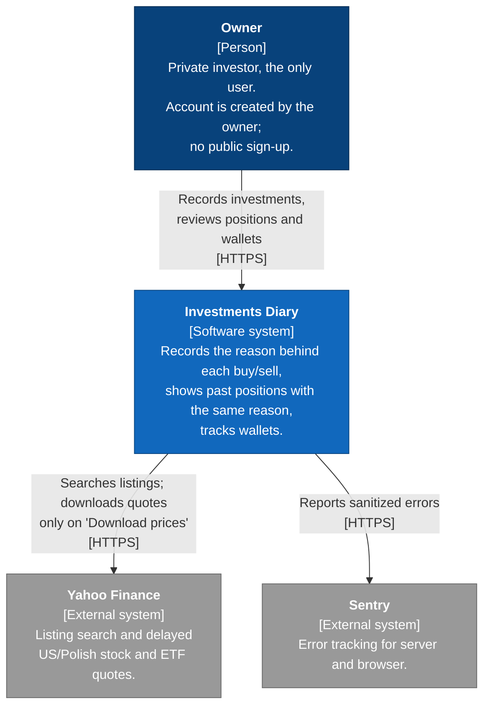
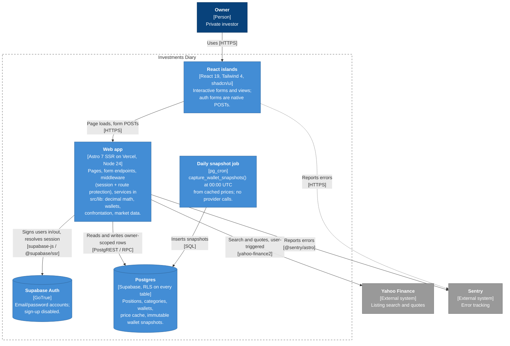

# Investments Diary

A private, single-user investment journal. It records the **reason** behind every buy and sell, and when you record a
new investment it shows you your earlier positions bought for the same kind of reason, with how each one turned out.
The aim is to help you understand your own decisions and stick to a strategy.

The app never writes or suggests the reason text, and every position is visible only to its owner.

## What it does

- **Record investments** — pick a Yahoo stock/ETF listing from search, then enter buy price, buy date, and optionally
  quantity, commission, broker label and a free-text reason.
- **Reason categories** — define and edit your own list and assign one to each investment.
- **Confrontation** — while recording, see your existing positions in the same category with their results.
- **Close, edit, delete, restore** — close a position with sell price and commission; edit factual fields (the reason
  locks shortly after it is written); deleted entries are recoverable.
- **Wallets** — several named wallets in USD, PLN or EUR (no FX conversion), with live value and daily snapshots
  captured at 00:00 UTC.
- **Prices** — quotes download only when you click **Download prices** (Yahoo via `yahoo-finance2`); manual prices
  remain available as a fallback.
- **Owner-created accounts only** — public sign-up is closed.

Requirements live in [context/foundation/prd.md](context/foundation/prd.md); the stack rationale is in
[context/foundation/tech-stack.md](context/foundation/tech-stack.md).

## Tech stack

- [Astro](https://astro.build/) 7 (SSR, `output: "server"`) with [React](https://react.dev/) 19 islands
- [TypeScript](https://www.typescriptlang.org/) 6, [Tailwind CSS](https://tailwindcss.com/) 4, shadcn/ui
- [Supabase](https://supabase.com/) — auth and Postgres (with RLS on every table)
- [Vercel](https://vercel.com/) serverless functions on Node 24
- Vitest, Stryker (mutation testing), Playwright, Sentry

## Architecture (C4)

### Level 1 — System context



### Level 2 — Containers



## Getting started

Prerequisites: Node.js 24 (see `.nvmrc`), npm, and Docker (~7 GB RAM) for local Supabase.

```bash
npm install
cp .env.example .env
npx supabase start          # first run downloads Docker images
```

Copy the local API URL and publishable key printed by the CLI into `.env`:

```
SUPABASE_URL=http://127.0.0.1:54321
SUPABASE_KEY=<your-local-publishable-key>
```

Then generate types, create an account and start the app:

```bash
npx astro sync
npm run user:create -- --email you@example.com   # prompts for a password (12+ characters)
npm run dev
```

Sign in at <http://localhost:4321/auth/signin>. Local Supabase Studio is at <http://localhost:54323>; stop the stack
with `npx supabase stop`.

> Dev runs against **local Supabase only**: `npm run dev` throws if `SUPABASE_URL` is not a local address. Production
> keys live only in Vercel, never in a local env file.

## Commands

Run everything from the repository root.

### App and code quality

| Command                  | Use it to                                                                                  |
| ------------------------ | ------------------------------------------------------------------------------------------ |
| `npm run dev`            | Start the dev server at <http://localhost:4321> (needs local Supabase running)             |
| `npm run stop`           | Stop the dev server                                                                        |
| `npm run build`          | Production SSR build into `.vercel/output/` (there is no preview server with this adapter) |
| `npx astro sync`         | Regenerate `.astro/` types — run on a fresh checkout and after changing `env.schema`       |
| `npx astro check`        | Type-check `.astro` files (CI runs it; no npm script)                                      |
| `npm run lint`           | ESLint with type-checked rules (also runs on pre-commit)                                   |
| `npm run lint:fix`       | Auto-fix ESLint issues                                                                     |
| `npm run lint:sh`        | Shellcheck the shell scripts (needs the tools image, see `tools:build`)                    |
| `npm run format`         | Format everything with Prettier                                                            |
| `npm run verify`         | `astro sync` + ESLint + unit tests in one go — the quick "am I done?" check                |
| `npm test`               | Run unit tests (Vitest)                                                                    |
| `npm run test:mutation`  | Stryker mutation tests on financial modules; pass a key, e.g. `-- result`, to narrow scope |

### Database and integration tests

These need Docker and `npx supabase start`. They refuse to target production.

| Command                       | Use it to                                                                              |
| ----------------------------- | -------------------------------------------------------------------------------------- |
| `npm run smoke`               | Walk sign-in, protected pages, diary flows and cross-account isolation against `BASE_URL` (default `http://localhost:4321`); the dev server must be running. Creates test accounts — never point at production |
| `npm run test:decimal-db`     | Exact decimal transport, snapshot pagination and ownership                             |
| `npm run test:contract-db`    | Replay all migrations and check every table is readable only by its owner              |
| `npm run test:wallet-cron`    | Verify the daily wallet-snapshot job registration (00:00 UTC)                          |
| `npm run test:recovery-db`    | Rehearse the manual price recovery template in a disposable database                   |
| `npm run test:user-create-db` | Verify `user:create` accounts can really sign in through Supabase Auth                 |
| `npm run test:demo-db`        | Test the demo-data loader                                                              |
| `npm run probe:market-data -- --live` | Check that public Yahoo search/quotes work for `AAPL` and `PKO.WA`             |

### Accounts, demo data and operations

| Command                                  | Use it to                                                                          |
| ---------------------------------------- | ---------------------------------------------------------------------------------- |
| `npm run user:create -- --email <email>` | Create a confirmed account on local Supabase (hidden password prompt, twice)       |
| `npm run seed:demo`                      | Load a demo account with 5 wallets and 100 investments (see [Demo data](#demo-data)) |
| `npm run seed:demo -- --reset`           | Restore the original demo fixtures                                                 |
| `npm run configure:wallet-cron`          | Re-apply the daily snapshot job on local Supabase (repair helper)                  |
| `npm run tools:build`                    | Build the Docker tools image (psql, shellcheck, jq, curl) — needed for production `user:create` and `lint:sh` |
| `npm run test:sentry-probe`              | Exercise Sentry error handling against a fake local ingest endpoint                |
| `npm run check:sentry-build`             | After `npm run build`, check public assets for source maps and leaked secrets      |

Every script's prerequisites and data effects are documented in [scripts/README.md](scripts/README.md).

## Project structure

```
.
├── src/
│   ├── pages/          # Astro pages and endpoints (dashboard, auth, wallets, market-prices)
│   ├── components/     # Astro and React components; shadcn/ui primitives in ui/
│   ├── lib/            # Business logic: decimal math, wallets, confrontation, market data, auth
│   ├── db/             # Generated database types
│   └── middleware.ts   # Session handling and PROTECTED_ROUTES
├── supabase/           # config.toml and SQL migrations
├── scripts/            # Testing, demo, accounts, observability, automation, deployment helpers
├── tests/              # Database and end-to-end tests
├── context/            # PRD, roadmap, deployment plan and per-change plans
└── public/             # Static assets
```

Routes: `/auth/signin` (sign-in), `/dashboard` (positions), `/dashboard/new` (record an investment),
`/dashboard/positions/[id]`, `/dashboard/wallets`, `/dashboard/deleted`. Protection is in `src/middleware.ts` — add
paths to `PROTECTED_ROUTES` to require authentication.

## Configuration

Environment variables are declared in the `astro:env` schema in `astro.config.mjs` and are server-only. Read them via
`astro:env/server`, never `process.env`. To add one: edit `env.schema`, then `.env`, then run `npx astro sync`.

| Variable                                                  | Purpose                                              |
| --------------------------------------------------------- | ---------------------------------------------------- |
| `SUPABASE_URL`, `SUPABASE_KEY`                            | Required. Local stack in dev; hosted project in Vercel |
| `PUBLIC_SENTRY_DSN`, `SENTRY_ORG`, `SENTRY_PROJECT`, `SENTRY_AUTH_TOKEN` | Optional error tracking                |
| `E2E_USERNAME`, `E2E_PASSWORD`                            | Credentials for end-to-end tests                     |

## End-to-end tests

Browser tests use [Playwright](https://playwright.dev/) and live in `tests/e2e/`. They run against **local Supabase
only**; some specs create their own fixtures through the local Auth admin API and refuse a remote backend.

One-time setup:

```bash
npm install
npx playwright install chromium                  # download the browser
npx supabase start                               # Docker must be running
npm run user:create -- --email e2e@example.com   # dedicated test account
```

Put that account's credentials in `.env` (see `.env.example`):

```
E2E_USERNAME=e2e@example.com
E2E_PASSWORD=<the password you chose>
```

Run the tests:

```bash
npx playwright test                              # full suite
npx playwright test tests/e2e/login.spec.ts      # a single spec
npx playwright test --ui                         # interactive UI mode
npx playwright test --headed                     # watch the browser
npx playwright show-report                       # open the HTML report of the last run
```

How it works:

- Playwright starts the app itself (`npm run build && npm run dev` on `127.0.0.1:4321`) and reuses a server that is
  already running. Set `E2E_PORT` if port 4321 is taken.
- A `setup` project ([tests/e2e/auth.setup.ts](tests/e2e/auth.setup.ts)) signs in once with `E2E_USERNAME` and
  `E2E_PASSWORD` and saves the session to `playwright/.auth/user.json` (gitignored); the `chromium` project reuses it.
- Failures keep screenshots, and traces are recorded on the first retry, in `test-results/` and `playwright-report/`.
- The build is served through Astro dev because the Vercel adapter has no preview server, so these tests don't prove
  parity with the deployed runtime. Details: [context/foundation/test-stack.md](context/foundation/test-stack.md).

## Demo data

With local Supabase running, enter a password (zsh) and seed the demo account:

```zsh
read -s "DEMO_USER_PASSWORD?Demo password (at least 12 characters): "
print
export DEMO_USER_PASSWORD
npm run seed:demo
```

Sign in with `wallet-demo@example.test` and that password. The demo has 100 investments across five wallets with
synthetic daily history; reruns preserve your edits. Click **Download prices** on Positions to fetch a real quote for
the Apple holding in **Demo · Rising**. Details: [scripts/README.md](scripts/README.md#local-demo).

## Deployment

Deploys to Vercel; pushing to `master` deploys automatically. Manual path:

```bash
npx vercel link                                  # first time only
npx vercel env add SUPABASE_URL production
npx vercel env add SUPABASE_KEY production
npx vercel deploy --prod
```

Do not pull production values into a local env file. Procedure, rollback and wallet-cron operations are in
[context/deployment/deploy-plan.md](context/deployment/deploy-plan.md).

## CI

GitHub Actions runs on every push and PR to `master` (docs-only changes are skipped):

- **ci** — `astro sync`, unit tests, lint, `astro check` and build.
- **decimal-transport** — local Supabase plus `test:decimal-db`, `test:wallet-cron`, `test:recovery-db`,
  `test:user-create-db` and `test:contract-db`.
- **smoke** — after merge to `master` only: local Supabase, build, dev server and `npm run smoke`.

## Contributing notes

- Every new Supabase table needs RLS with per-operation, per-role policies. Migrations go in
  `supabase/migrations/YYYYMMDDHHmmss_short_description.sql`.
- Before declaring work done, follow the `verify` skill in [.claude/skills/verify/SKILL.md](.claude/skills/verify/SKILL.md).
- Agent instructions live in [CLAUDE.md](CLAUDE.md) (`AGENTS.md` is a symlink to it).

## License

MIT
