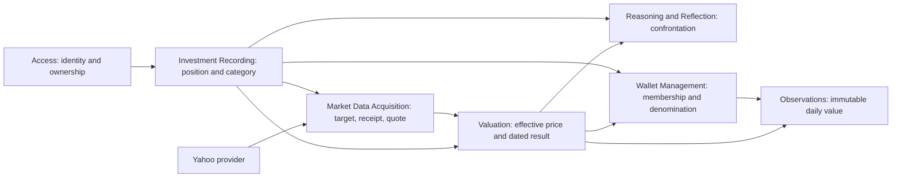

# Investments Diary — Domain Map

## Phase 1 — Discovery

### Scope and evidence rules

The discovered repository is `investments-diary/` (the request spells it “investmenst-diary”). All citations below are relative to that repository. This is a source-based domain map, not an implementation plan. The repository revision inspected is `b111cc7`; the existing untracked domain draft was treated as a hypothesis and rechecked, not used as evidence. No production code was changed.

Requirements exist: the PRD is a draft updated 2026-11-02 (`context/foundation/prd.md:4`, `context/foundation/prd.md:6`). Read sources include the PRD, foundation tech-stack document, README, original shape narrative, and the confrontation and close-position decision briefs. The required-stock-selection and denomination migrations also record explicit owner decisions (`supabase/migrations/20261102120000_require_position_stock_selection.sql:2`, `supabase/migrations/20261030140619_set_wallet_denominations.sql:1`). Historical narrative explains how the model evolved; it does not automatically override the newer PRD. The README remains starter-oriented (`README.md:1`); it cannot substitute for the product requirements.

The product exists to preserve the author's original investment reasoning and show comparable past reasoning with outcomes before another investment is saved (`context/foundation/prd.md:23`, `context/foundation/prd.md:52`, `context/foundation/prd.md:54`). It deliberately avoids recommendations and declared-strategy enforcement (`context/foundation/prd.md:235`, `context/foundation/prd.md:266`). The primary domain is therefore **investment reasoning and reflection**, rather than brokerage accounting. Wallets explicitly are not broker accounts (`context/foundation/prd.md:275`).

### Stack and location of rules

Declared stack: Astro 7, React 19, TypeScript 6, Tailwind 4, Supabase and Vercel (`README.md:9`). Package declarations corroborate Astro, React, Supabase, Tailwind and the pinned Yahoo adapter (`package.json:44`, `package.json:49`, `package.json:53`, `package.json:56`, `package.json:58`); Node is 24.x (`package.json:6`). The foundation rationale prioritizes time spent on confrontation over infrastructure wiring (`context/foundation/tech-stack.md:24`, `context/foundation/tech-stack.md:30`).

| Layer | Discovered location | Verified example |
|---|---|---|
| HTTP/API and server page orchestration | `src/pages/`, `src/pages/api/auth/`, `src/middleware.ts` | Save handler `src/pages/dashboard/new.astro:119`; market POST guard `src/lib/market-data/endpoint.ts:34`; gated dashboard `src/middleware.ts:22` |
| Application services | `src/lib/services/` | Position creation `src/lib/services/positions.ts:247`; closing `src/lib/services/positions.ts:302`; reassignment `src/lib/services/positions.ts:336` |
| Domain calculations and policies | `src/lib/`, `src/lib/validation/`, shared `src/types.ts` | Confrontation `src/lib/confrontation.ts:17`; result `src/lib/result.ts:27`; wallet value `src/lib/wallet.ts:31`; input rules `src/lib/validation/position.ts:70` |
| Persistence and transaction guards | `supabase/migrations/`, `src/db/` | Owner-scoped foreign keys `supabase/migrations/20260929141102_create_diary_core.sql:40`; immutable stock selection `supabase/migrations/20261102080240_validate_selection_without_update_privilege.sql:7`; same-currency move RPC `supabase/migrations/20261030140619_set_wallet_denominations.sql:31` |
| External market adapter | `src/lib/market-data/` | Yahoo listing normalization `src/lib/market-data/yahoo.ts:179` |
| UI | `src/components/`, `src/pages/`, `src/layouts/` | Price context `src/components/market-prices/PriceContext.astro:68`; new investment form invocation `src/pages/dashboard/new.astro:198` |
| Verification | `src/**/*.test.ts`, `tests/database/`, `tests/e2e/`, `scripts/testing/` | Effective valuation integration `tests/database/effective-valuations.test.ts:127`; production-privilege access fixtures `scripts/testing/database/contract/access.mjs:142`; capture/recovery assertions `scripts/testing/database/test-market-price-recovery.mjs:67` |

There is no dedicated domain directory in the inspected source tree. Business rules are distributed across pure functions, service predicates, validators and SQL. A table is not automatically an aggregate, and a read model is not automatically an aggregate root.

### Code-first vocabulary pass

The code vocabulary was collected from exported types/functions, SQL table/constraint/trigger names and state unions, separately from matching PRD wording. Actual names include `ReasonCategory`, `PositionDetail`, `ConfrontationPosition`, `WalletSnapshot`, `MarketSelectionChoice`, `EffectivePrice` and `MarketDataFailureReason` (`src/types.ts:13`, `src/types.ts:36`, `src/types.ts:39`, `src/types.ts:147`, `src/types.ts:177`, `src/types.ts:222`, `src/types.ts:205`). Pure functions add `confrontationState`, `positionResult`, `walletValue`; SQL adds targets, receipts, leases and cooldowns (`src/lib/confrontation.ts:17`, `src/lib/result.ts:27`, `src/lib/wallet.ts:31`, `supabase/migrations/20261030162000_pending_stock_selections.sql:2`, `supabase/migrations/20261030162000_pending_stock_selections.sql:22`, `supabase/migrations/20261030110418_market_price_persistence.sql:154`). This was a separate extraction pass in the same analysis, not a blinded independent audit.

## Phase 2 — Analysis

### Ubiquitous Language

Definitions below are paraphrases grounded in the cited sources. “NOT FOUND in code” refers to an absent implemented policy, not necessarily an absent word or column. Search scopes and synonyms follow the table.

| Term | Meaning | Definition source | Actual code occurrence / implementation |
|---|---|---|---|
| Diary | Private investment record belonging to one account; not a separately persisted container | `context/foundation/prd.md:252` | Implicit through owner RLS `supabase/migrations/20260929141102_create_diary_core.sql:59` |
| Author | Person recording their own investments and reasoning | `context/foundation/prd.md:39` | `user_id`, request-scoped author client `src/lib/services/positions.ts:23` |
| Position / investment | One recorded investment with purchase facts, category, optional reasoning and eventual sale | `context/foundation/prd.md:117`, `context/foundation/prd.md:121`, `context/foundation/prd.md:138` | `positions` `supabase/migrations/20260929141102_create_diary_core.sql:27`; `PositionDetail` `src/types.ts:36`; UI “New investment” `src/pages/dashboard/new.astro:193` |
| Purchase facts | Buy price/date, optional quantity and broker label | `context/foundation/prd.md:117` | `buy_price`, `buy_date`, `quantity`, `broker_label` `supabase/migrations/20260929141102_create_diary_core.sql:32` |
| Broker label | Free text describing the broker; no managed broker identity | `context/foundation/prd.md:275` | `broker_label` `supabase/migrations/20260929141102_create_diary_core.sql:35` |
| Reason | Author-written optional explanation of why they bought | `context/foundation/prd.md:121` | `reason_text` `supabase/migrations/20260929141102_create_diary_core.sql:37`; inserted `src/lib/services/positions.ts:289` |
| Reason category | Required author-defined grouping of reasoning, independent of free-text prose | `context/foundation/prd.md:123`, `context/foundation/prd.md:125` | `reason_categories` `supabase/migrations/20260929141102_create_diary_core.sql:12`; `category_id` `supabase/migrations/20260929141102_create_diary_core.sql:36` |
| Reason lock | Reason becomes uneditable shortly after first writing; adding a previously missing reason starts the window | `context/foundation/prd.md:142`, `context/foundation/prd.md:285` | **NOT FOUND in code as an enforced policy**; deferred comment `supabase/migrations/20260929141102_create_diary_core.sql:4` and misleading guard claim `supabase/migrations/20261030122155_effective_snapshots_and_wallet_moves.sql:58`; search A below |
| Removed category | Soft-retired category whose name remains visible on past positions with a removed marker | `context/foundation/prd.md:286` | Partial: `deleted_at` `supabase/migrations/20260929141102_create_diary_core.sql:18` and exclusion from choices `src/lib/services/positions.ts:67`. **NOT FOUND in code: removal operation and historical removed marker**; search B below |
| Confrontation | Same-category past positions and outcomes shown during recording to prompt reflection | `context/foundation/prd.md:163`, `context/foundation/prd.md:227` | `confrontationState` `src/lib/confrontation.ts:17`; `listConfrontationPositions` `src/lib/services/positions.ts:99` |
| Result | Dated gain/loss; percent can exist without quantity, monetary amount requires quantity | `context/foundation/prd.md:232`; precise formula is code-derived `src/lib/result.ts:14` | `positionResult` `src/lib/result.ts:27`; dated description `src/lib/result.ts:62` |
| Open / closed | No recorded sale / complete sale-price and sale-date pair; closing covers the whole position | `context/foundation/prd.md:138`; `context/archive/2026-10-27-close-position/plan-brief.md:21` | Pair constraint `supabase/migrations/20261028120000_close_position.sql:5`; state selection `src/lib/result.ts:28` |
| Close | Record a whole-position sale, including a zero sale price | `context/archive/2026-10-27-close-position/plan-brief.md:21`, `context/archive/2026-10-27-close-position/plan-brief.md:22` | `closePosition` `src/lib/services/positions.ts:302`; nonnegative sale constraint `supabase/migrations/20261028120000_close_position.sql:6` |
| Deleted / restored | Hidden but recoverable position, retaining purchase and sale facts | `context/foundation/prd.md:146` | `deletePosition`, `restorePosition`, `deleted_at` `src/lib/services/positions.ts:190`, `src/lib/services/positions.ts:201` |
| Stock selection / target | Durable stock identity chosen at creation; metadata selection does not prove trading currency | `context/foundation/prd.md:117`, `context/foundation/prd.md:186` | `market_listing_targets` `supabase/migrations/20261030162000_pending_stock_selections.sql:2`; `market_target_id` required `supabase/migrations/20261102120000_require_position_stock_selection.sql:50` |
| Selection receipt | Temporary owner/wallet-bound proof of an unsaved search choice, not a holding's durable identity | Code-derived `supabase/migrations/20261030162000_pending_stock_selections.sql:22`; lifetime `src/lib/services/market-selections.ts:37` | `market_selection_receipts`, `valid_until` `supabase/migrations/20261030162000_pending_stock_selections.sql:27`; receipt read `src/lib/services/market-selections.ts:38` |
| Instrument label | Stored diary display label, distinct from provider identity | `context/foundation/prd.md:177` | `instrument` `supabase/migrations/20260929141102_create_diary_core.sql:30`; new inserts derive symbol `supabase/migrations/20261102080240_validate_selection_without_update_privilege.sql:22`; historical backfill preserves labels `supabase/migrations/20261102120000_require_position_stock_selection.sql:5` |
| Listing | Exchange-specific stock/ETF identity, with verified trading currency and timezone before a quote is applied | `context/foundation/prd.md:176`, `context/foundation/prd.md:186` | `MarketListing` `src/types.ts:184`; owner link `supabase/migrations/20261030110418_market_price_persistence.sql:103` |
| Automatic quote | Cached regular-session provider price with separate market and download timestamps | `context/foundation/prd.md:179`, `context/foundation/prd.md:197` | `MarketQuote` `src/types.ts:192`; selected view exposes both times `supabase/migrations/20261030110418_market_price_persistence.sql:215` |
| Manual price / correction | Saved author price/date; for a linked holding it wins until a strictly later market timestamp arrives | `context/foundation/prd.md:129`, `context/foundation/prd.md:133` | `current_price`, `price_date`, database-stamped `manual_price_saved_at` `supabase/migrations/20261030110418_market_price_persistence.sql:139` |
| Effective price | Price selected for a result: sale, eligible manual correction, cached automatic quote, manual fallback, otherwise missing | `context/foundation/prd.md:180`; precedence detailed by code `supabase/migrations/20261030110418_market_price_persistence.sql:217` | `position_effective_prices` `supabase/migrations/20261030110418_market_price_persistence.sql:210`; `composeEffectivePrice` `src/lib/services/effective-price.ts:138` |
| Download prices | Explicit authenticated user action; metadata search is separate and does not fetch quotes | `context/foundation/prd.md:181`, `context/foundation/prd.md:191` | POST-only `src/lib/market-data/endpoint.ts:37`; search calls `searchListings` `src/lib/services/market-selections.ts:86` |
| Cooldown / refresh lease | Failed-attempt waiting period / temporary exclusive claim to provider work | `context/foundation/prd.md:193`; lease is code-derived `supabase/migrations/20261030110418_market_price_persistence.sql:154` | `cooldown_until`, `lease_token`, `lease_until` `supabase/migrations/20261030110418_market_price_persistence.sql:154`; failures preserve cache `supabase/migrations/20261030110418_market_price_persistence.sql:198` |
| Wallet | Author-owned named grouping with editable starting value, fixed currency and no deletion | `context/foundation/prd.md:171`, `context/foundation/prd.md:202` | `wallets` `supabase/migrations/20261019112848_create_wallets.sql:12`; `Wallet` `src/types.ts:110` |
| Starting value | Editable nonnegative basis for wallet performance value, not a cash balance | `context/foundation/prd.md:171`; nonnegative rule `supabase/migrations/20261019112848_create_wallets.sql:17` | `starting_value` `supabase/migrations/20261019112848_create_wallets.sql:17` |
| Live value / coverage / freshness | Starting value plus realised and open monetary results; exclusions are counted; freshness uses counted open quotes | `context/foundation/prd.md:171` | `walletValue`, `notCounted`, `asOf` `src/lib/wallet.ts:31`, `src/lib/wallet.ts:47`, `src/lib/wallet.ts:61` |
| Denomination | USD, PLN or EUR wallet currency, frozen after creation; no FX conversion | `context/foundation/prd.md:202` | `wallets.currency` required `supabase/migrations/20261030140619_set_wallet_denominations.sql:7`; immutable `supabase/migrations/20261030140619_set_wallet_denominations.sql:16` |
| Reassignment | Move a non-deleted open or closed position between the author's same-currency wallets | `context/foundation/prd.md:209` | `movePosition` `src/lib/services/positions.ts:336`; `move_position_to_wallet` `supabase/migrations/20261030140619_set_wallet_denominations.sql:31` |
| Observation | Immutable daily record of the cached diary value; no reconstructed market or cash history | `context/foundation/prd.md:172` | `WalletSnapshot` `src/types.ts:147`; `wallet_snapshots` `supabase/migrations/20261028160000_wallet_snapshots.sql:2`; UTC job `supabase/migrations/20261028170000_register_daily_wallet_snapshot_job.sql:14` |
| Account / sign-in | Access identity created by the owner outside the app; private diary access after authentication | `context/foundation/prd.md:255` | Supabase `getUser` and route guard `src/middleware.ts:18`; public signup disabled in repository config `supabase/config.toml:169` |

**Search A — reason-lock absence.** Searched `src/`, `supabase/migrations/`, `tests/` and `scripts/` for `reason_text`, `reason.*lock`, `lock.*reason`, `thesis`, `editable`, `first_written`, `reason_saved` and timestamp variants. Only comments declare the lock; the only production service write to reason text is the create insert (`src/lib/services/positions.ts:289`). No first-written timestamp or time-based reason guard was found. The authenticated update grant explicitly includes `reason_text` (`supabase/migrations/20261030122155_effective_snapshots_and_wallet_moves.sql:61`). The access test uses it as a granted column for cross-owner isolation, not for age-based protection (`scripts/testing/database/contract/access.mjs:59`, `scripts/testing/database/contract/access.mjs:147`). These are static findings; no direct API exploit was executed.

**Search B — category lifecycle absence.** Searched `src/`, `supabase/migrations/`, `tests/` and `scripts/` for `reason_categories`, category/categor variants together with `rename`, `remove`, `retire`, `archive`, `restore`, `deleted_at` and `removed`. SQL declares retirement storage and owner updates (`supabase/migrations/20260929141102_create_diary_core.sql:18`, `supabase/migrations/20260929141102_create_diary_core.sql:56`), and choices filter deleted categories (`src/lib/services/positions.ts:67`). Production services only list and find/create categories (`src/lib/services/positions.ts:63`, `src/lib/services/positions.ts:219`); position projections retrieve only their name (`src/lib/services/positions.ts:79`, `src/lib/services/positions.ts:125`). No category-management write or historical removed marker was found. Therefore the state has partial representation, rather than being entirely absent.

### Context boundaries and overloaded terms

These are candidate semantic boundaries inferred from the discovered vocabulary, not assertions that separate services already exist.

| Term | Meaning and context A | Meaning and context B | Boundary implication |
|---|---|---|---|
| Reason | Investment rationale in **Reasoning and Reflection**: `reason_text` `supabase/migrations/20260929141102_create_diary_core.sql:37` | Failure code in **Market Data Acquisition**: `MarketDataFailureReason` `src/types.ts:205`, endpoint `reason` `src/lib/market-data/endpoint.ts:39` | Keep business rationale distinct from operation failure |
| Current price | Manual stored fact in **Investment Recording**: stamped on explicit manual update `supabase/migrations/20261030110418_market_price_persistence.sql:146` | Selected valuation in **Valuation**: DTO overwrites open `current_price` with effective selection `src/lib/services/effective-price.ts:138` | A read DTO's price must not be mistaken for the manual fact |
| Selection | Chosen stock in **Investment Recording**: immutable target `supabase/migrations/20261102080240_validate_selection_without_update_privilege.sql:8` | Chosen price source in **Valuation**: `selected_source` `supabase/migrations/20261030110418_market_price_persistence.sql:232` | Qualify as stock selection or price selection |
| Result | Investment gain/loss in **Reasoning and Reflection** `src/lib/result.ts:27` | Command outcome in **Application Orchestration**, e.g. `CreatePositionResult` `src/lib/services/positions.ts:35` | A successful save does not mean a profitable investment |
| Confirmed | Saved investment in **Recording** `context/foundation/prd.md:228` | Verified listing in **Market Data** `context/foundation/prd.md:178`; confirmed identity in **Access** `context/foundation/prd.md:258` | Avoid one universal confirmation state |

“Snapshot” and “observation” name the same persisted concept, not competing bounded contexts (`src/types.ts:147`, `context/foundation/prd.md:172`). “Wallet” and “broker label” are intentionally different concepts, not synonyms (`context/foundation/prd.md:275`).

### Context map

Arrows indicate data or policy dependencies, not mandatory synchronous calls. Yahoo normalization is an existing translation boundary (`src/lib/market-data/yahoo.ts:179`). Shared price selection feeds position reads (`src/lib/services/positions.ts:77`) and observation capture (`supabase/migrations/20261030122155_effective_snapshots_and_wallet_moves.sql:29`). A position references its category and wallet by identity with owner-scoped foreign keys (`supabase/migrations/20260929141102_create_diary_core.sql:40`, `supabase/migrations/20261019112848_create_wallets.sql:58`); this does not make the entire diary one aggregate. Reflection is a read policy over positions, not a new entity. Observation capture and live valuation cross contexts while historical observations remain independent of subsequent position changes (`context/foundation/prd.md:172`).

### Aggregate candidates and invariant status

**Status vocabulary:** *enforces* = executable guard at the named layer; *declares* = only commentary or intent; *ignores* = no implemented operation/guard; *contradicts* = executable permission or behavior permits the opposite. Application-only enforcement is explicitly distinguished from database enforcement. Candidates describe possible consistency boundaries, not prescribed class names.

| Candidate | Invariant and business source | Implementation status and evidence |
|---|---|---|
| **Position — reasoning record** | Category required, prose optional; category must belong to author (`context/foundation/prd.md:123`, `context/foundation/prd.md:219`) | **Enforces in DB:** non-null category, owner FK `supabase/migrations/20260929141102_create_diary_core.sql:36`, `supabase/migrations/20260929141102_create_diary_core.sql:40`; optional prose `supabase/migrations/20260929141102_create_diary_core.sql:37` |
| Position | Once first-written lock window expires, reason cannot change; initially absent reason may be added later (`context/foundation/prd.md:142`, `context/foundation/prd.md:285`) | **Declares lock** `supabase/migrations/20260929141102_create_diary_core.sql:4`; **contradicts database protection** by granting `reason_text` updates `supabase/migrations/20261030122155_effective_snapshots_and_wallet_moves.sql:61` without an age guard; **ignores app add-later path**, insert only `src/lib/services/positions.ts:289`. Duration itself remains undecided |
| Position | Purchase facts stay correctable (`context/foundation/prd.md:142`, `context/foundation/prd.md:145`) | **Ignores app correction workflow**: current service writes are price `src/lib/services/positions.ts:145`, delete/restore `src/lib/services/positions.ts:193`, `src/lib/services/positions.ts:204`, sale `src/lib/services/positions.ts:310` and move `src/lib/services/positions.ts:337`. Direct column permission exists `supabase/migrations/20261030122155_effective_snapshots_and_wallet_moves.sql:60`, but does not deliver the user workflow |
| Position | Closing records a complete whole-position sale, zero allowed; first close wins in the current flow (`context/archive/2026-10-27-close-position/plan-brief.md:21`, `context/archive/2026-10-27-close-position/plan-brief.md:38`, `context/archive/2026-10-27-close-position/plan-brief.md:63`) | **Enforces sale pair, nonnegative price and date ≥ buy in DB** `supabase/migrations/20261028120000_close_position.sql:5`. **Enforces first-close in service only** `src/lib/services/positions.ts:311`. **Contradicts universal first-close protection**: direct `sell_price`/`sell_date` update grant remains `supabase/migrations/20261030122155_effective_snapshots_and_wallet_moves.sql:61`; no transition guard found. Reopening/corrections were deferred, not permanently forbidden (`context/archive/2026-10-27-close-position/plan-brief.md:23`) |
| Position | Deletion is recoverable, not ordinary physical destruction (`context/foundation/prd.md:146`) | **Enforces for authenticated clients:** soft-delete/restore `src/lib/services/positions.ts:190`, `src/lib/services/positions.ts:201`; no delete grant `supabase/migrations/20261102150000_grant_core_table_access.sql:9`. This does not promise survival of privileged account deletion: owner FK has cascade `supabase/migrations/20260929141102_create_diary_core.sql:29` |
| **Reason category** | Rename updates all historical names; removal keeps history and marks category removed (`context/foundation/prd.md:286`) | **Enforces referential name lookup** `src/lib/services/positions.ts:90`; **ignores management workflow and removed marker**, name-only historical projection `src/lib/services/positions.ts:125`. Retirement column exists `supabase/migrations/20260929141102_create_diary_core.sql:18` |
| Reason category | Active names unique per author ignoring case (code-derived rule) | **Enforces in DB** via partial unique index `supabase/migrations/20260929141102_create_diary_core.sql:23`; service resolves concurrent duplicate creation `src/lib/services/positions.ts:234`. Whether this rule is desired product language is not explicitly decided in PRD |
| **Stock selection / listing target** | Every saved position has immutable creation-time identity; saved selection does not expire (`context/foundation/prd.md:117`, `context/foundation/prd.md:188`) | **Enforces in DB:** NOT NULL `supabase/migrations/20261102120000_require_position_stock_selection.sql:50`; immutable target/receipt `supabase/migrations/20261102080240_validate_selection_without_update_privilege.sql:7`. Receipt expiry checked only on insert `supabase/migrations/20261102080240_validate_selection_without_update_privilege.sql:12`; service explicitly distinguishes temporary receipt from durable holding `src/lib/services/market-selections.ts:37` |
| Stock selection / listing target | Search proves metadata, not currency/timezone; only verified download attaches quote (`context/foundation/prd.md:186`, `context/foundation/prd.md:190`) | **Enforces relevant guards:** new insert clears listing `supabase/migrations/20261102080240_validate_selection_without_update_privilege.sql:23`; direct listing-column updates revoked `supabase/migrations/20261102140000_revoke_listing_column_updates.sql:6`; listing currency must match wallet `supabase/migrations/20261030110418_market_price_persistence.sql:116`. Historical Apple assignment was an explicit owner-approved backfill, not inferred stock matching `supabase/migrations/20261102120000_require_position_stock_selection.sql:2` |
| **Owned listing quote cache** | Manual correction wins until provider market time is strictly later, including identical resubmission (`context/foundation/prd.md:133`) | **Enforces in DB:** timestamp stamp on explicit price update `supabase/migrations/20261030110418_market_price_persistence.sql:145`; comparison uses `<=` `supabase/migrations/20261030110418_market_price_persistence.sql:219`. View centralizes precedence, including sale `supabase/migrations/20261030110418_market_price_persistence.sql:217` |
| Owned listing quote cache | Failed refresh retains last valid quote; failed-attempt cooldown at least 15 minutes (`context/foundation/prd.md:193`, `context/foundation/prd.md:195`) | **Enforces in DB:** failed outcome changes status/cooldown but preserves quote values `supabase/migrations/20261030110418_market_price_persistence.sql:198`; claim respects lease/cooldown `supabase/migrations/20261030110418_market_price_persistence.sql:157`. Monotonic market time is also code-derived `supabase/migrations/20261030110418_market_price_persistence.sql:187` |
| **Wallet** | Every position belongs to one wallet owned by same author; wallet cannot be deleted (`context/foundation/prd.md:171`) | **Enforces in DB:** required wallet and composite FK `supabase/migrations/20261019112848_create_wallets.sql:54`; soft deletion prohibited `supabase/migrations/20261019150000_prevent_wallet_deletion.sql:3`; no ordinary DELETE grant `supabase/migrations/20261102150000_grant_core_table_access.sql:7` |
| Wallet | Currency frozen; reassignment only among owned, non-deleted matching-currency wallets; no conversion (`context/foundation/prd.md:202`, `context/foundation/prd.md:209`) | **Enforces in DB:** currency guard `supabase/migrations/20261030140619_set_wallet_denominations.sql:16`; ordered locks, ownership checks and equality `supabase/migrations/20261030140619_set_wallet_denominations.sql:36`, `supabase/migrations/20261030140619_set_wallet_denominations.sql:40`, `supabase/migrations/20261030140619_set_wallet_denominations.sql:47`. Integration tests inspect direct move denial and preservation of other facts `tests/database/effective-valuations.test.ts:159`, `tests/database/effective-valuations.test.ts:163` |
| Wallet | Value = starting value + realised + open monetary results; missing quantities/quotes excluded and counted; only open counted quotes set freshness (`context/foundation/prd.md:171`) | **Enforces in pure calculation with caller scope:** `src/lib/wallet.ts:47`, `src/lib/wallet.ts:55`, `src/lib/wallet.ts:64`. Caller must supply non-deleted members (`src/lib/wallet.ts:29`); list service filters deletion `src/lib/services/positions.ts:81`. Capture has corresponding SQL `supabase/migrations/20261030122155_effective_snapshots_and_wallet_moves.sql:20`. No numerical contradiction established |
| **Daily wallet observation** | At most one observation per wallet/UTC day; ordinary clients cannot rewrite it; later changes do not rewrite past history (`context/foundation/prd.md:172`) | **Enforces in DB:** composite PK and date/value checks `supabase/migrations/20261028160000_wallet_snapshots.sql:15`; clients read-only `supabase/migrations/20261028160000_wallet_snapshots.sql:24`; capture conflict does nothing `supabase/migrations/20261030122155_effective_snapshots_and_wallet_moves.sql:50`. Midnight UTC job is explicitly registered and checked active `supabase/migrations/20261028170000_register_daily_wallet_snapshot_job.sql:8`, `supabase/migrations/20261028170000_register_daily_wallet_snapshot_job.sql:14`, `supabase/migrations/20261028170000_register_daily_wallet_snapshot_job.sql:22` |

Confrontation is a **policy/read model**, not an aggregate candidate: same-category filtering is executable (`src/lib/confrontation.ts:35`, `src/lib/confrontation.ts:39`), ownership/deletion filtering comes from the query and RLS (`src/lib/services/positions.ts:106`, `supabase/migrations/20260929141102_create_diary_core.sql:59`), and dates accompany results (`src/lib/result.ts:68`). However, “always before save” (`context/foundation/prd.md:87`) is **contradicted as an unconditional workflow requirement** by a save path that does not depend on successful confrontation loading (`src/pages/dashboard/new.astro:119`, `src/pages/dashboard/new.astro:178`). The earlier brief deliberately accepted no-JS bypass (`context/archive/2026-10-16-reason-confrontation/plan-brief.md:34`, `context/archive/2026-10-16-reason-confrontation/plan-brief.md:80`); product intent needs reconciliation with the newer PRD.

### Model vs. code discrepancies

These are domain gaps, not a claim that every unfinished requirement is an accidental regression. “Code” means a known promised capability or rule is missing; “decision” means intent or conflicting sources prevent choosing a side. Documentation is marked for correction only with a cited superseding decision.

| ID | Document says X | Code does Y | Evidence | What needs fixing |
|---|---|---|---|---|
| D1 | Reason locks shortly after first writing; missing reason can be added later | Lock is deferred in commentary; authenticated clients retain reason update permission; app only writes it at creation | `context/foundation/prd.md:142`, `context/foundation/prd.md:285`; `supabase/migrations/20260929141102_create_diary_core.sql:4`, `supabase/migrations/20261030122155_effective_snapshots_and_wallet_moves.sql:61`, `src/lib/services/positions.ts:289` | **Code**, with PO decision on lock duration before a precise acceptance test can be agreed |
| D2 | Author can correct factual fields | No app workflow for correcting buy facts, quantity, broker or category after save; direct grants do not provide one | `context/foundation/prd.md:142`; `src/lib/services/positions.ts:145`, `src/lib/services/positions.ts:193`, `src/lib/services/positions.ts:204`, `src/lib/services/positions.ts:310`, `src/lib/services/positions.ts:337`; `supabase/migrations/20261030122155_effective_snapshots_and_wallet_moves.sql:60` | **Code**; establish which fields are correctable without breaking locked reasoning |
| D3 | Categories editable; removed categories retain marked historical names | Only list/find/create in app; removal storage exists but historical projections only retrieve name | `context/foundation/prd.md:125`, `context/foundation/prd.md:286`; `src/lib/services/positions.ts:63`, `src/lib/services/positions.ts:219`, `src/lib/services/positions.ts:125`; `supabase/migrations/20260929141102_create_diary_core.sql:18` | **Code** for rename/retirement/history marker; **decision** for offering/restoring removed categories |
| D4 | Competing closes must not overwrite first sale; corrections deferred | Service protects first-close, but authenticated direct updates can rewrite or clear sale pair | `context/archive/2026-10-27-close-position/plan-brief.md:23`, `context/archive/2026-10-27-close-position/plan-brief.md:63`; `src/lib/services/positions.ts:311`, `supabase/migrations/20261030122155_effective_snapshots_and_wallet_moves.sql:61`, `supabase/migrations/20261028120000_close_position.sql:5` | **Code** for consistency of the current transition rule; PO confirms future correction semantics separately |
| D5 | Confrontation appears before saving | Save is not gated on the panel; a failed history load is expressly tolerated | `context/foundation/prd.md:87`; `src/pages/dashboard/new.astro:119`, `src/pages/dashboard/new.astro:178`; accepted historical bypass `context/archive/2026-10-16-reason-confrontation/plan-brief.md:80` | **Decision**: newer PRD and older accepted tradeoff disagree; do not silently weaken either |
| D6 | Wrong stock must be deleted/recreated; existing-position re-link retired 2026-11-02 | Currency mismatch UI tells author to choose a listing from investment detail, while old action returns 409 | `context/foundation/prd.md:117`, `context/foundation/prd.md:187`; `src/components/market-prices/PriceContext.astro:75`, `src/lib/market-data/endpoint.ts:44` | **Code/UI copy**; later decision clearly establishes intended behavior |
| D7 | Supported US/Polish stocks/ETFs, with USD/PLN/EUR wallets | Adapter checks equity/ETF and currency, but accepts syntactically valid exchange codes without US/Polish restriction | `context/foundation/prd.md:176`, `context/foundation/prd.md:202`; `src/lib/market-data/yahoo.ts:184`, `src/lib/market-data/yahoo.ts:186`, `src/lib/market-data/yahoo.ts:212` | **Decision**: is US/Polish a minimum supported set or an exclusive scope? EUR alone does not prove wider exchange intent |
| D8 | Original shape notes allow account creation and free-text instrument; README says no domain migrations needed | Public signup disabled, durable stock selection required, multiple domain tables/migrations exist | `context/foundation/shape-notes.md:141`, `context/foundation/shape-notes.md:153`, `README.md:113`; `supabase/config.toml:169`, `supabase/migrations/20261102120000_require_position_stock_selection.sql:50`, `supabase/migrations/20260929141102_create_diary_core.sql:27` | **Documentation**: annotate historical shape decisions / refresh README. Explicit superseding decisions: owner-created accounts `context/foundation/prd.md:255` (2026-11-02), required search selection `context/foundation/prd.md:117` (2026-10-30 revision) |
| D9 | Stack handoff declares no background jobs | Database registers a daily capture job | `context/foundation/tech-stack.md:19`; `supabase/migrations/20261028170000_register_daily_wallet_snapshot_job.sql:14` | **Documentation**: later approved observation capability `context/foundation/prd.md:172` and executable scheduling migration `supabase/migrations/20261028170000_register_daily_wallet_snapshot_job.sql:1` supersede the original handoff assumption |

### Risks and unknowns that are not proven discrepancies

- **Parallel wallet arithmetic:** live TS calculation (`src/lib/wallet.ts:31`) and capture SQL (`supabase/migrations/20261030122155_effective_snapshots_and_wallet_moves.sql:20`) can drift, but two implementations do not establish wrong behavior. Existing recovery assertions verify concrete normal/manual capture values and preservation of past observations (`scripts/testing/database/test-market-price-recovery.mjs:69`, `scripts/testing/database/test-market-price-recovery.mjs:97`, `scripts/testing/database/test-market-price-recovery.mjs:101`); read integration compares list and summary valuation (`tests/database/effective-valuations.test.ts:136`). A full cross-language parity property was not established in this analysis.
- **Scheduling:** the early migration says production scheduling is separate (`supabase/migrations/20261028160000_wallet_snapshots.sql:63`); a later migration registers and validates it (`supabase/migrations/20261028170000_register_daily_wallet_snapshot_job.sql:14`, `supabase/migrations/20261028170000_register_daily_wallet_snapshot_job.sql:22`). These are migration sequence, not evidence of broken production capture. Whether all migrations reached the hosted database remains an operator question.
- **Signup:** repository config disables it (`supabase/config.toml:169`), while change metadata remains `implementing` (`context/changes/close-public-signup/change.md:4`). Neither proves the hosted setting; no production failure is claimed.
- **Operator recovery:** a manual/sale view recovery template exists and explicitly keeps capture using that same view (`context/deployment/automatic-stock-prices-manual-selection.sql:34`). Source behavior described above assumes the normal migration-defined view, not an unknown hosted recovery state.
- **Dates and privacy:** future buy dates are prevented in the application (`src/lib/validation/position.ts:68`) and explicitly not in DB checks (`supabase/migrations/20260929141102_create_diary_core.sql:6`). Owner RLS and grants were inspected, but hosted isolation was not executed. Do not equate an inspected guard with a passing runtime test.

## Phase 3 — Classification and priorities

### Subdomains: Core / Supporting / Generic

Every glossary concept above belongs to an area below. Classification is based on the product's purpose, rather than implementation size or financial risk alone.

| Domain area and included concepts | Classification | Product-grounded justification |
|---|---|---|
| Reasoning record: diary, author role, position, purchase facts, broker label, reason, category, removed category, reason lock, delete/restore | **Core** | Preserves what the investor actually thought, the gap portfolio trackers leave; honest recall is the differentiator (`context/foundation/prd.md:31`, `context/foundation/prd.md:52`, `context/foundation/prd.md:72`) |
| Reflection: confrontation and dated result interpretation; open/closed outcome and whole-position close | **Core** | Closes the reason/outcome loop and surfaces prior reasoning before another decision (`context/foundation/prd.md:54`, `context/foundation/prd.md:138`, `context/foundation/prd.md:227`). Result arithmetic supports this core policy but is not itself a competitive algorithm |
| Valuation: effective price, manual price/correction, automatic quote, listing identity, instrument label and quote coverage/freshness | **Supporting** | Supplies usable outcomes; automated prices are explicitly secondary and manual fallback acceptable (`context/foundation/prd.md:60`). Delayed data is sufficient, no guaranteed feed (`context/foundation/prd.md:270`) |
| Stock selection workflow: target and receipt | **Supporting** | Provides reliable creation-time identity needed for valuation, not the reason the diary is distinctive (`context/foundation/prd.md:117`, `context/foundation/prd.md:186`). Receipt is a technical proof, not a new business entity to expose to users |
| Wallet management: wallet, starting value, denomination, live value, exclusions and reassignment | **Supporting** | Organizes diary performance without becoming broker/cash accounting; requirements are should-have (`context/foundation/prd.md:171`, `context/foundation/prd.md:202`, `context/foundation/prd.md:209`, `context/foundation/prd.md:275`) |
| Observation history: immutable daily observation, capture day/time and source context | **Supporting** | A record of diary value, explicitly not reconstructed market history (`context/foundation/prd.md:172`) |
| Access: account, sign-in/sign-out and account provisioning | **Generic** | Standard identity mechanisms satisfy essential privacy guardrail; proprietary authentication is not the product advantage (`context/foundation/prd.md:68`, `context/foundation/prd.md:255`) |
| Provider transport and operational coordination: Yahoo adapter, refresh lease, cooldown, cancellation and failure codes | **Generic mechanisms** | Standard external-service reliability machinery implements the product's bounded explicit-download rule (`context/foundation/prd.md:181`, `context/foundation/prd.md:193`). Price-source precedence remains a Supporting domain policy, not generic plumbing |

### Aggregate refactoring ranking

Value is the importance of the candidate's invariants to the core purpose; risk is the currently observed weakness of enforcement. This ranks consistency boundaries, not individual screens or infrastructure chores. Confrontation remains a separately listed policy decision below.

| Rank | Aggregate candidate | Value / risk | Why now | Verifiable “done when…” condition |
|---|---|---|---|---|
| **1** | **Position, especially original reasoning** | Very high / high | D1 lets the evidence the product depends on be rewritten; D2 leaves missing/incorrect facts uncorrectable through the app; D4 has transition protection only in service predicates | Given the agreed lock window W, an authenticated-owner test adds a reason to a reasonless position, edits it within W, and proves a direct write after W is refused; tests also show the allowed factual correction preserves locked reason and stock identity |
| **2** | **Reason category** | High / high | Confrontation groups by this identity; missing lifecycle prevents the investor's vocabulary evolving while preserving history (D3) | A workflow test renames a category and reads the new name on past positions; retirement leaves those positions readable with a removed marker and new-choice/restoration behavior matches the PO decision |
| **3** | **Stock selection / listing target** | Medium-high / medium | Identity immutability is strongly guarded, but wrong-currency recovery copy contradicts it and geographical scope is undecided (D6, D7) | Tests show target changes and retired relink requests fail without provider work; a wrong-currency holding displays the owner-approved recovery instruction; search fixtures match the agreed geographic scope |
| **4** | **Owned listing quote cache** | Medium-high / low-medium | Price precedence determines reflection evidence, but SQL already guards timestamps, leases and cache retention | A database test covers equal/older/newer market timestamps after an identical manual resubmission, proving only a strictly later timestamp replaces the manual correction and a failed download retains the last valid quote |
| **5** | **Wallet** | Medium / low-medium | Membership and denomination are guarded; largest remaining risk is consistent valuation across reads and capture | For the same frozen fixture of open/closed, deleted, quantity-missing and quote-missing members, captured and live values, coverage counts and oldest-open dates are exactly equal; cross-currency moves leave every position fact unchanged |
| **6** | **Daily wallet observation** | Medium / low | Write permissions, uniqueness and scheduling are explicit; history loss cannot be repaired by backfill under the model | Capturing twice on one UTC day leaves exactly one row per wallet; editing, closing, delete/restore and reassignment leave the previous day's rows byte-for-byte unchanged |

**Number-one priority: protect the Position's original reasoning.** The product promises evidence of what the author thought, rather than a story rewritten after an outcome (`context/foundation/prd.md:72`, `context/foundation/prd.md:143`). Its original migration explicitly defers the lock (`supabase/migrations/20260929141102_create_diary_core.sql:4`), while a later comment claims it exists (`supabase/migrations/20261030122155_effective_snapshots_and_wallet_moves.sql:58`) and the executable grant still allows writing the reason (`supabase/migrations/20261030122155_effective_snapshots_and_wallet_moves.sql:61`). A missing edit screen does not enforce this invariant at the persistence boundary. Resolve the short lock duration and acceptable corrections, then use the rank-one condition to judge completion; this map intentionally does not choose an implementation design.

**High-value policy decision outside aggregate ranking:** settle whether confrontation is required on every save or best-effort when history cannot load (D5). Done when the PO-approved behavior appears in the PRD and a workflow test verifies it under history-read failure and JavaScript-disabled submission. A scoring/recommendation system is not a proposed replacement (`context/foundation/prd.md:235`).

### Quick questions and responsible roles

| Question | Role able to answer | Resolves |
|---|---|---|
| How many minutes is “shortly” for the reason lock, and is first-writing measured at successful save? | Product owner | Rank 1 acceptance boundary; `context/foundation/prd.md:142`, `context/foundation/prd.md:285` |
| Can category assignment change after the prose locks, or is it part of the protected reasoning? | Product owner | D1/D2; category's causal meaning in confrontation |
| Is confrontation mandatory when history fails, or does the accepted best-effort/no-JS exception remain? | Product owner | D5; `context/archive/2026-10-16-reason-confrontation/plan-brief.md:80` versus `context/foundation/prd.md:87` |
| May a removed category be selected for a new position, and can it be restored? | Product owner | D3; explicitly unresolved `context/foundation/prd.md:286` |
| Does US/Polish describe an exclusive exchange boundary or only a guaranteed supported set? | Product owner | D7; `context/foundation/prd.md:176` |
| Are sale corrections/reopening intended in the pending factual-edit scope, and which facts can change? | Product owner | D4; explicit deferral `context/archive/2026-10-27-close-position/plan-brief.md:23` |
| Is hosted public signup disabled, and has the close-public-signup change been accepted despite its metadata? | Operator / account owner | Hosted configuration uncertainty, `supabase/config.toml:169`, `context/changes/close-public-signup/change.md:4` |
| Is exactly one active UTC `wallet-daily-observations` job installed, and was its last run successful? | Database operator | Verify `cron.job` and latest `cron.job_run_details`; source schedule `supabase/migrations/20261028170000_register_daily_wallet_snapshot_job.sql:14` |
| Is the hosted effective-price view the normal version or the manual recovery version? | Database operator | Determine active valuation policy; `context/deployment/automatic-stock-prices-manual-selection.sql:34` |

### Verification and limitations

This is a static source inspection. Source paths and line numbers were checked against the local checkout, including production services, SQL grants/triggers, selected integration tests and decision history. Targeted absence searches covered both implementation and tests; a missing feature is not inferred solely from an absent UI label. Tests were read as evidence of intended coverage, not run or claimed passing. The full application verification workflow is for code changes; this deliverable changes only Markdown, so validation checks artifact structure and citations instead.

No hosted Supabase, cron execution history, Vercel state or private diary data was accessed. Required product sources exist; the limitation is their draft status and incomplete acceptance criteria, not their absence (`context/foundation/prd.md:4`, `context/foundation/prd.md:92`, `context/foundation/prd.md:288`). Aggregate and bounded-context boundaries remain analytical candidates until the owner confirms the unresolved semantics. Historical evidence files in `context/domain/evidence/` were left untouched and are not authoritative sources for this refreshed artifact.
