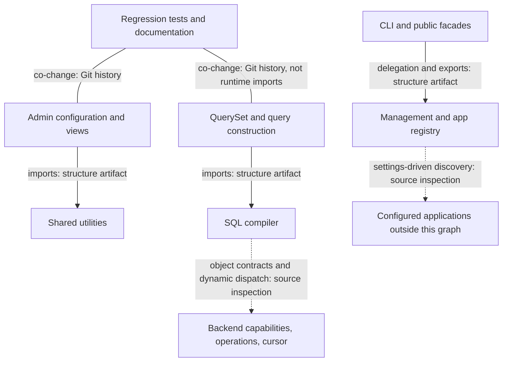

# Django repository map

## 1. TL;DR

This repository is Django itself: one distributable Python framework package, supported by regression suites, documentation, and auxiliary JavaScript tooling. Its practical layers are public entry points and app discovery, feature implementations, shared helpers, and database contracts—not separately deployed services. Work concentrates in the ORM, admin, shared utilities, and database backends, while substantial documentation activity reflects contribution and compatibility work. The clearest change hazards are query correctness, database compatibility, admin permissions/editing, and external-input handling. Directory boundaries understate dynamic ORM/backend contracts and overstate the significance of thin public facades. This is an activity-and-structure map for **3 November 2025–3 November 2026**, with a static graph at HEAD `b501b8493f31cf8cba31211d59b3b78642b8cb02`, not a production reliability assessment.

Arrows identify selected relationships, not a complete architecture. Sources throughout: [territory/activity](artifact-1-territory.md) (**T**), [structure/contracts](artifact-2-structure.md) (**S**), and [contributors](artifact-3-contributors.md) (**C**). Numbers below are reused from these artifacts; their full tables are intentionally not repeated.

## 2. Territory

**Large responsibilities.** The ORM (`django/db/models`, 126 qualifying commits) handles models, fields, expressions, query construction, and execution coordination. Admin (`django/contrib/admin`, 86) coordinates editing, search, permissions, and UI. Shared utilities (`django/utils`, 60) span unrelated parsing, HTML, filesystem, translation, and compatibility concerns; they are not one cohesive product subsystem. Backends (`django/db/backends`, 55) implement database capabilities and execution/schema contracts. These are the four implementation areas prioritized by S.

**Beyond those four.** Authentication, GeoDjango, forms, serialization, HTTP, and the test framework remain functional responsibilities, not unimportant leftovers. GeoDjango has 33 annual implementation touches and seven recent repair commits in T, but its cycles were not reviewed in S; native/spatial-stack dependencies remain incompletely mapped. Documentation is a major work surface: `docs/internals` has 92 touches, mostly contribution, release, security, and deprecation guidance rather than runtime logic.

**Depth does not follow folder size or graph degree.** `django/apps/__init__.py` is a four-line public facade with 82 mapped incoming files. `django/db/__init__.py` has 101, but also creates connection/router objects and registers lifecycle signals. Deeper down, `django/db/models/sql/compiler.py` has only three direct mapped consumers: dynamic dispatch hides much of its behavioral reach. `django/contrib/admin/options.py` is a real coordination hub, with 41 outgoing mapped targets. Read contracts as well as directory names and degree counts. (S)

**Activity over time.** ORM work stayed steady: 37 touches in December–February versus 38 in August–October. Admin and backend work eased after earlier peaks; utilities and internal documentation grew. Admin's spring burst included accessibility, actions, and permission work; October utility work included parsing/cache security and compatibility changes. GIS and email documentation show campaigns rather than steady volume. These are overlapping commit-touch counts; partial November buckets are not used for trend inference, and one year cannot establish recurring seasonality. (T)

## 3. Real relationships

### What changes together, and why

- **Implementation plus regression coverage — Git history (T):** admin/admin-view tests share 34 commits; utilities/utility tests share 22; GIS/GIS tests share 20. These are delivery boundaries crossing top-level folders, usually desirable coverage coordination. They are not import edges and do not establish harmful architecture. ORM/query tests share 17 commits; field and query work needs its matching suites outside the production package.
- **Query behavior plus database contracts — Git history and source contracts (T, S):** ORM/backends share 11 commits in the filtered coupling cohort. Base/PostgreSQL feature files share eight, or 80% of the PostgreSQL file's ten cohort commits. These capability files are manually maintained runtime code, not generated output: changing a base default requires reviewing backend overrides and SQL behavior.
- **Dynamic runtime boundaries — source inspection, incompletely represented by imports (S):** `ENGINE` selects a backend through `load_backend()`; `compiler_module` selects compiler classes dynamically; SQL compilation reads `connection.features` and `connection.ops`. These are known behavioral dependencies even where the graph lacks direct implementation-to-implementation edges. Settings-driven app/admin discovery likewise extends beyond the checkout.
- **Editorial coordination — Git history and contribution workflow (T):** release notes, deprecations, and AUTHORS accompany many unrelated changes. They are manually maintained source text, with editorial/merge cost rather than a shared runtime contract.

### Cycles to preserve when editing imports

**Import graph plus AST/source verification (S):** PostgreSQL `base.py ↔ introspection.py`, SQLite `base.py ↔ features.py`/`operations.py`, and Oracle `base.py ↔ operations.py`/`utils.py` are module-level loops. Initialization depends on shared driver/version symbols being defined in time. ORM `manager.py ↔ query.py` and `lookups.py ↔ sql/query.py`, admin `options.py ↔ checks.py`/`views/main.py`, and utilities `html.py ↔ text.py` contain local/deferred return imports. Moving these imports to module scope can change working initialization behavior; their existence alone is not a defect. Public models/admin re-exports also participate in module-level loops.

These are selected two-file cycles, not a complete cycle inventory. A directory render drops external edges, so an internally acyclic directory can still participate in a wider cycle. (S)

### Looks alarming, but is not evidence of a risk zone

- **Generated/imported translations (T):** Transifex fetch, catalog normalization, and compilation explain imports touching 68–115 files. This is tool-driven propagation, generally cheaper than manually coordinating every output; source/tool validation still matters. These imports were excluded. The artifacts identify no comparable mock-generated coupling; do not invent one.
- **Build/configuration and CI noise (T, S):** build/deployment/CI/dependency configuration was filtered from activity rankings; no build/dist nodes occur in the saved graph. The coverage-workflow rollback belongs to CI, not runtime/internal-doc instability. The artifacts do not establish a trial-and-error CI pattern. Runtime settings implementation remains eligible code; configuration syntax alone is not a risk signal.
- **Required workflow companions (T):** release notes, credits, tests, and documentation explain broad co-change. Count the underlying workflow once, not each companion file as a separate coupling problem; editorial source files are not generated artifacts.
- **Inflated severity indicators (T, S):** admin's 77.9% correction share includes 31 UI/accessibility/wording corrections; behavior/security repairs alone are 41.9%. A 610-file reverse-reach envelope reflects cyclic static connectivity, not 610 predicted failures. Closed unmerged PRs include replacements and submission issues, not a rejected-bug count.

## 4. Risk zones

These are review priorities supported by **repair evidence plus a separate structural mechanism**, not a ranking of production incidents. Annual and recent repair totals are overlapping views of the same history, not independent signals; neither are multiple cycles within one mechanism. Shared ORM/backend contracts count as one cross-cutting cause across the first two zones.

| Product behavior | Where it lives | Why extra review is warranted |
|---|---|---|
| Correct filtering and retrieval of application data | `django/db/models/query.py`, `django/db/models/sql/query.py`, `django/db/models/sql/compiler.py`; regression entry: `tests/queries` | **T:** 28 recent ORM repair commits include wrong JSON results and alias/deferred-field errors; **S:** lookup/query cycles and dynamic compiler contracts make local edits affect query construction and execution. |
| Consistent database execution and schema behavior | `django/db/backends/base/features.py`, `django/db/backends/base/operations.py`, `django/db/backends/postgresql/base.py`, `django/db/backends/postgresql/introspection.py` | **T:** five recent backend repairs include constraints, schema alteration, and conversion; **S:** inherited capability/operation contracts span backends, and module-level initialization loops add ordering constraints. |
| Safe administrative editing, search, and permissions | `django/contrib/admin/options.py`, `django/contrib/admin/views/main.py`; regression entry: `tests/admin_views` | **T:** ten recent repairs include permissions, unsafe links, and search behavior; **S:** the options/checks/changelist hub has runtime cycles and 25 mapped transitive dependents, including auth/content-type integrations. |
| Safe handling of untrusted headers, markup, and language input | `django/utils/http.py`, `django/utils/html.py`, `django/utils/text.py`, `django/utils/translation/trans_real.py` | **T:** eight recent utility repairs include parsing/resource exhaustion; **S:** HTML/text and translation facade/implementation loops cross helper boundaries. This is a broad review category, not evidence that those cycles caused the security repairs. |

## 5. Whom to ask

Candidates reflect authored work in the same one-year window, **not ownership, availability, or review authority**. Match the question to the topic. (C)

| Risk zone | Initial candidates and topic fit |
|---|---|
| Data filtering/retrieval | **Clifford Gama** for cross-database JSON/NULL/expression preparation; **Jacob Walls** for ordering, aliases, and primary-key defaults. |
| Database execution/schema behavior | **Tim Graham** for backend hooks, feature flags, and introspection contracts; **Simon Charette** for quoting, placeholders, and cross-database SQL semantics. Their activity does not establish expertise in the particular initialization cycles. |
| Administrative editing/permissions | **Jacob Walls** for list-editable security and deletion/editing behavior; **Natalia Bidart** for safe links, permission failures, and action querysets. |
| Untrusted-input handling | **Natalia Bidart** for parsing, exhaustion protection, and HTML truncation; **Sarah Boyce** for translation-cache exhaustion and CSP helpers. |

For spatial work outside these four zones, start with **Jacob Walls** for raster/geometry safety or **David Smith** for GEOS bindings and spatial lookups. Concentrated authorship alone does not establish a bus-factor risk without team and review evidence.

## 6. First day

Read these eight entry files in order, following the named symbols rather than reading every line of the largest modules:

1. `django/__main__.py` — see the thin CLI delegation to management.
2. `django/apps/__init__.py` — distinguish the public registry/configuration facade from implementation.
3. `django/db/__init__.py` — locate connections, routing, and request-lifecycle wiring.
4. `django/db/utils.py` — follow `ConnectionHandler.create_connection()` and `load_backend()` to the settings-driven backend boundary.
5. `django/db/models/query.py` — follow QuerySet execution coordination and the manager boundary.
6. `django/db/models/sql/compiler.py` — trace `execute_sql()`, capability checks, operations, and cursor use.
7. `django/db/backends/base/features.py` — understand shared defaults before changing backend overrides.
8. `django/contrib/admin/options.py` — locate ModelAdmin hooks, checks, permissions, and changelist creation; use the risk-zone regression entry when pursuing an admin change.

**Path check:** every file/directory in sections 4 and 6 was checked for on-disk existence in the current checkout before this map was saved. Historical Selenium/admin test helpers were replaced by Playwright infrastructure; do not use deleted paths as starting points. (T)

## 7. Limitations

- **Time and population:** T and C cover 3 November 2025–3 November 2026 by committer timestamp, reachable from the analyzed HEAD; no unmerged branches or working-tree changes. Recent repairs use 3 August–3 November 2026. S is a static snapshot at that HEAD, not a year of architecture evolution.
- **Method:** T retains 871 qualifying non-merge commits after heuristic noise filtering. Co-change additionally removes commits spanning eight or more eligible area buckets, leaving 848. Pair percentages use shared commits divided by the smaller filtered activity count; they are not dependency probabilities or proof of change cost. C further excludes dependency-only admin/GIS maintenance, explaining its 85/32 totals versus T's 86/33.
- **Graph coverage:** Tach maps production Python (700 nodes, 3,328 edges), excluding tests and docs. There is **no dependency graph for JavaScript, CSS/templates, documentation, tests, native spatial libraries, or external applications** in these artifacts: cross-layer dependency reach is **unknown**, not absent. Dynamic loading and object contracts are only partly captured. GeoDjango cycles were not inspected in the selected review.
- **Interpretation:** no runtime/test validation was performed by S; selected cycles are not demonstrated failures. This synthesis reuses the three artifacts and checks path existence only; it does not refresh metrics or add a new architectural audit. Counts do not establish complexity, production incidence, security completeness, or current support availability.
- **Missing evidence:** open-bug counts are unavailable because GitHub Issues is disabled and the external tracker export was inaccessible. Authored commits omit review-only knowledge; no identifiable AI-agent authorship does not imply no AI assistance. Recheck paths and refresh evidence after moving beyond the recorded HEAD.
